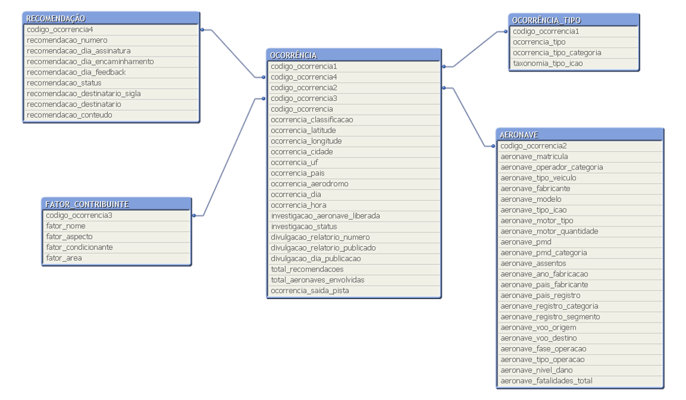

# Análise de Acidentes Aéreos - CENIPA

Projeto em andamento de análise exploratória de dados sobre ocorrências aeronáuticas no Brasil, registradas pelo CENIPA entre 2007 e 2023 (9.821 ocorrências).

Dataset: https://www.kaggle.com/datasets/victorhiga/acidentes-areos-fav

## Pergunta central

Quais fatores estão mais associados ao número de fatalidades (`aeronave_fatalidades_total`) em ocorrências aeronáuticas no Brasil?

## Dados

Do conjunto original de 5 tabelas, uso 3:

- `ocorrencia.csv` - dados gerais de cada ocorrência
- `aeronave.csv` - detalhes das aeronaves envolvidas
- `ocorrencia_tipo.csv` - tipo/categoria da ocorrência

## O que já foi feito

**Preparação**

- Carregamento dos 3 datasets (encoding latin-1, separador `;`), primeiro olhar nos dados e checagem de valores faltantes.
- Construção de um banco SQLite local com as 3 tabelas, para fazer as análises em SQL a partir do Python.

**Integridade do JOIN entre `ocorrencia` e `aeronave`**

- O JOIN gera mais linhas (9.926) do que a tabela `ocorrencia` sozinha (9.821).
- A diferença se explica pelas ocorrências com mais de uma aeronave: a soma de `total_aeronaves_envolvidas` dá exatamente 9.926. Não há duplicação nem perda de dados.
- `aeronave_fatalidades_total` é registrada por aeronave (e não é o total da ocorrência repetido), então somar essa coluna depois do JOIN não conta a mesma morte duas vezes.

**Quais tipos de ocorrência são mais letais?**

- A tabela `ocorrencia_tipo` tem 10.284 linhas para 9.821 ocorrências: algumas ocorrências têm mais de um tipo (ex.: "perda de controle no solo" e "pouso longo" no mesmo evento). Decidi contar a ocorrência em todos os tipos associados a ela.
- Para medir letalidade, uso a proporção de ocorrências com pelo menos uma fatalidade em cada tipo, em vez do número total de mortes, para que um único acidente com muitas vítimas não distorça o resultado.
- Primeira contagem de ocorrências totais e fatais por tipo já calculada em SQL.

## Próximos passos

- Calcular a proporção de ocorrências fatais por tipo e visualizar em gráfico
- Tendência de fatalidades por ano, com visualização
- Tratar os demais dados faltantes
- Análise univariada e bivariada mais ampla, correlações e conclusões

## Stack

Python, Pandas, SQLite3, Seaborn e Matplotlib, rodando no Google Colab.
